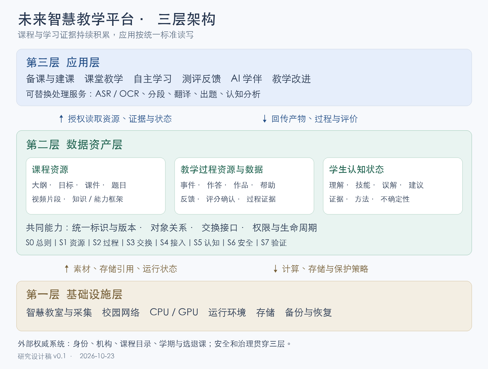

# 未来智慧教学平台三层架构具体描述

研究设计稿 v0.1｜2026-10-23

## 一、体系定位

未来智慧教学平台拟建设为由学校统一治理、以教学数据资产为核心、支持应用持续演进的开放教学体系。体系由基础设施层、数据资产层和应用层构成。基础设施层提供教学现场数字化、计算、存储、网络和运行保障；数据资产层将课程内容、教学过程及学生认知状态组织为具有统一标识、明确语义、版本关系、使用权限和来源证据的可交换资产；应用层调用这些资产开展备课、授课、学习、评价、辅导和教学改进，并将新产生的资源、过程记录与评价结果回传数据资产层。

建设的核心是使课程与学习证据能够持续积累、被独立理解、按授权流动，并由不同应用复用。教师建设一门课程后，可以在多个教学工具中使用同一套经过审定的内容；学生在不同场景下产生的学习证据可以关联到同一课程目标；认知分析与学习建议可以保留依据并接受复核。

三层是逻辑职责划分，不预设三个物理系统、三套数据库或某种部署产品。各层之间通过明确的数据契约衔接；安全、身份、运行观测与治理贯穿三层。本文描述拟建体系，不根据原始材料的历史数字认定当前建设进度。

## 二、第一层：基础设施层

### 2.1 层的职责

基础设施层为教学活动及其数字化提供物理和运行条件，使课堂素材能够采集、传输、处理、保存和恢复。基础设施应提供可供上层调用的稳定能力，并将采集任务、文件、时间和设备来源关联起来。

| 能力域 | 建设内容 | 向数据资产层提供的结果 |
|---|---|---|
| 教学现场采集 | 智慧教室、录播设备、课件与板书采集、音频、实验实训终端 | 带课次、时间、来源和采集状态的原始素材 |
| 网络与传输 | 校园网络、教学现场接入、大文件传输、断点续传、时间同步 | 可追踪的传输任务及到达回执 |
| 计算与运行环境 | CPU/GPU、虚拟化或容器运行环境、任务调度、必要的推理运行条件 | 可分配的计算资源与任务执行状态 |
| 存储与保护 | 对象存储、结构化数据存储、备份、恢复、冷热分层 | 稳定存储引用、完整性校验与恢复能力 |
| 基础运行保障 | 监控、日志、告警、故障处置、账号和密钥管理 | 服务健康、容量、故障及恢复证据 |

### 2.2 与 AI 处理能力的分界

GPU 和任务运行环境属于基础设施；ASR、OCR、翻译、课程分段与题目生成属于可替换的处理服务，在应用层按统一接口调用基础设施。处理产生的字幕、版面识别结果、片段、题目等，经登记和必要审核后成为数据资产层的对象。

这一划分使更换识别或生成模型不会改变课程资产的基本身份，也不会丢失此前版本。原始视频、机器转写、人工校订字幕和教学成片应分别保存来源与版本关系。原始录像中的个人信息适用独立权限，教学成片获准公开不意味着原片可同时公开。

### 2.3 基础设施建设尺度

容量和性能按实际课时、码率、保留期限、同时在线人数、同步峰值及处理任务量测算。建设方案应分别说明原始素材、发布资源、过程记录和备份的容量，明确故障域、恢复路径以及资源访问责任。原始文档中的教室数量、设备型号和历史利用率不作为本稿的建设参数。

## 三、第二层：数据资产层

### 3.1 层的职责与资产含义

数据资产层是连接基础设施和教学应用的长期共享基础。它将文件和记录组织为可以检索、解释、核查、交换、复用和治理的对象。每项资产不仅具有内容，还应具备身份、来源、关系、版本、质量、权限和生命周期信息。

学校应掌握资产目录、标准定义、规范化记录、访问控制及独立导出恢复能力。管理控制、教师署名与著作权、第三方内容许可、学生作品权利及个人信息处理权限分别登记，不能以“数据资产”一词替代具体权利判断。

### 3.2 三类核心数据资产

| 数据域 | 回答的问题 | 主要对象 | 典型用途 |
|---|---|---|---|
| A. 课程资源数据 | 教什么、依据什么、内容如何组织 | 大纲、教学目标、课程结构、知识与能力框架、视频与片段、课件、教材、案例、题目、评分量规、实验任务、AI 教学策略配置 | 课程建设、检索、重组、跨应用复用 |
| B. 教学过程资源与数据 | 教与学怎样发生、留下什么作品与评价 | 教学活动、课堂实录、讨论、提问、板书、学习事件、作答、作品、教师反馈、同伴互评、AI 帮助记录、评分及确认记录 | 过程回顾、形成性评价、教学改进、成绩追溯 |
| C. 学生认知状态数据 | 对什么理解到何种程度、依据是什么、下一步需要什么 | 知识掌握估计、能力表现、误解假设、学习困难、自我判断、教师诊断、证据引用、不确定性和适用期限 | 个性化辅导、学习行动建议、教师干预与再评价 |

三类数据通过“课程—目标/知识点—资源—活动—作答—反馈—认知判断”连接。课程目标和知识点为三类数据提供共同语义；教学过程提供证据；认知状态是依据证据形成、可修订的判断。

原材料的“成绩与掌握数据”在本稿中作更清晰的分解：成绩提议、教师确认、教务归档属于 B 域的评价记录；知识掌握与误解判断属于 C 域。两者保留关联，但不得互相替代。

### 3.3 课程资源应保存到什么粒度

课程资源应能够从课程下钻到章节、学习单元、知识点、教学目标、资源版本、视频片段、题目和评分规则。对象间关系需单独表达，例如“该题测量哪个目标”“这个视频片段讲解哪个概念”“该活动需要哪些先修知识”。

课件至少区分可编辑源、可阅读版本和可运行交互版本。课程交换应同时声明这些表示形式是否具备、文件是否完整、运行依赖是否可取得。只有 PDF、图片或远程链接的材料，应如实登记其编辑和离线使用限制。

课程资源具有版本。教师修改已发布题目、教材内容或评分量规时，应生成新版本；已经完成的作答仍引用当时使用的版本。字幕、OCR、切片和知识点关系必须能够追溯到对应的原始资源版本。

### 3.4 教学过程资源应保存什么

教学过程同时产生事件和作品。事件表明谁在何时、哪个课程与任务版本下完成了什么操作；作品保存实际提交、讨论内容、批注、推导步骤或实验产物。仅保存“已提交”“得分 80”无法重建学习过程，因此关键事件必须关联相应作品、反馈和评分依据。

对课堂录音录像、讨论和互动，只采集经过界定且具有教学用途的内容。学校应能够取得必要的过程证据，同时避免将所有原始音视频、完整聊天或每一次鼠标动作无差别保存。AI 辅导记录保存必要的问题、可见帮助、引用材料及帮助级别；不要求获取模型内部推理过程。

过程资源可以转化为新的课程资源。例如，教师将一次典型讨论整理为案例时，须重新检查内容质量、个人信息和使用权利，生成新的案例对象，并保留其来源关系。

### 3.5 学生认知状态如何表达

学生认知状态应表达为“某个学习者在特定时间、特定目标及任务条件下的表现或估计”，而非永久、单一的学生标签。建议至少区分知识理解、程序性技能、迁移应用、常见误解和学习者自我判断等维度，各学科选择适用范围。

每条认知记录至少关联：学习者、课程或修读、目标及版本、维度、评价量尺、状态或数值、证据、形成方法、方法版本、证据时间窗口、更新时间、适用期限、审核状态，以及不确定性说明。

需要明确三种不同来源：直接观察，如某道题的作答；算法推断，如多次作答支持的掌握估计；人工判断，如教师依据作品形成的诊断。自我评价也须独立标明。点击、观看时长和任务完成可以作为参与证据，但不能单独得出掌握结论；缺少证据时应返回 unknown。

认知状态首先服务学习者理解自身学习和教师改进教学。认知推断不能直接转为正式成绩、纪律处置或固定能力等级。推荐应允许教师调整、学生反馈，并记录后续学习证据以检验建议是否有用。

### 3.6 数据资产层的六组内部服务

| 内部服务 | 具体责任 |
|---|---|
| 统一目录与对象注册 | 课程、课次、资源、活动、证据及认知状态登记；统一标识与外部标识映射 |
| 资源及关系管理 | 元数据、结构化课程、知识/能力框架、文件表示形式、语义关系和版本管理 |
| 教学证据管理 | 接收事件、保存作品和反馈、关联评分决定、对账与更正；可包含符合 xAPI 的 LRS |
| 认知状态管理 | 保存不同方法形成的状态、证据链、适用范围、可比性和复核记录 |
| 交换与访问服务 | API、批量包、增量同步、标准适配、权限校验、导入导出、订阅与回执 |
| 质量与生命周期治理 | 权利记录、分类分级、内容审核、质量检查、留存删除、审计和恢复验证 |

这些是第二层内部职责，不增加新的架构层。LRS 是学习记录服务的一种实现，不能独自承担完整课程、作品、权限和认知状态管理。

## 四、第三层：应用层

应用层围绕师生与教学管理的具体任务组织交互，通过数据资产层读取获准内容并回传产物。应用可以独立更新或替换，但必须遵循共同标识、数据语义、版本和权限规则。

| 应用群 | 使用的主要资产 | 必须回传的主要结果 |
|---|---|---|
| 教师备课与课程建设 | 大纲、目标、素材、历史资源版本 | 新资源、教学设计、题目草稿及审核记录 |
| 课堂与混合教学 | 已发布课程、课次安排、名单与任务 | 活动记录、课堂作品、讨论、反馈 |
| 自主学习与实验实训 | 授权资源、任务、学习目标 | 有效学习事件、作答、实验产物与求助记录 |
| 测评与评价 | 题目、量规、作答证据 | 评分提议、教师确认、评价解释和更正 |
| AI 学伴与个性化辅导 | 当前任务、最小必要认知状态及可用证据 | 帮助记录、诊断建议、推荐行动及效果反馈 |
| 教学质量与课程改进 | 获准的课程和群体聚合数据 | 改进建议、审议记录及验证结果 |
| 内容加工与模型服务 | 指定原始素材及处理要求 | ASR/OCR、切片、翻译、生成内容与来源版本 |

应用准入应按具体版本、运行实例、数据范围和用途登记。一个出题工具可以只获得课程目标和指定资源，不必访问学生名单；一个辅导工具可以读取当前任务所需证据，不应默认读取全校学生历史。

## 五、三层怎样协同运行

### 5.1 从课堂素材形成课程资产

课堂采集产生原始素材与课次标识；内容加工服务调用计算资源生成字幕、版面识别和片段候选；数据资产层登记来源和版本；教师修订并确认目标、内容和练习；审核通过后发布课程版本；教学应用按授权调用。

采集成功、转写成功、教师审定和课程发布是四个不同状态。后续阶段失败不应破坏已取得的原始素材。

### 5.2 从教学活动形成认知反馈

学生完成任务并提交作品；应用回传提交事件、作品和允许的帮助记录；评价服务依照当时的题目及量规形成反馈；教师对需要正式确认的结果作出决定；认知分析依据这些证据形成带方法版本和不确定性的状态；辅导应用提出下一步学习行动；后续作答用于检验和更新判断。

例如，一名学生能在提示下完成计算、却不能独立解释条件，系统应分别保存“提示条件下完成”的证据和“独立解释仍需观察”的状态，建议补充解释任务。它不能将有帮助的完成直接换算成独立掌握。

### 5.3 更换应用时资产怎样延续

授权导出课程、指定过程记录和适用认知状态；新应用先检查对象、引用、权限及格式支持范围；对不支持的交互类型、量尺或模型明确标记；导入后能够读取历史版本和证据，并在新的任务中生成新记录。导入数据不会自动获得重新评分、公开作品或继续使用认知模型的权限。

## 六、与学校既有系统的关系

教务和统一身份等系统提供人员、机构、课程目录、学期及选退课的权威数据。数据资产层保留这些标识和必要快照，增加教学资源、过程证据及认知状态的对象管理。正式学籍与成绩归档仍由相应权威业务系统负责。

| 数据对象 | 建议权威来源或决定方 | 数据资产层的责任 |
|---|---|---|
| 人员身份、机构 | 校级主数据与统一身份系统 | 获准引用、去标识映射及撤权联动 |
| 课程目录、学期、选退课 | 教务系统 | 同步版本和有效期，保留变化来源 |
| 已发布课程内容 | 获授权的课程组与审核流程 | 统一登记、保留版本和发布记录 |
| 作答与过程事件 | 产生该事实的教学应用或教学人员 | 核验来源、持久化、关联、对账 |
| 正式评分决定 | 获授权的教师及教务流程 | 保存决定与依据，接收归档回执 |
| 认知状态 | 经登记的评价方法或教师 | 保存方法、证据、时间和审核状态 |

“双向同步”指不同对象在明确写入责任下交换，不意味着任意应用可覆盖全校共同数据。身份变更、内容发布、作答提交、认知更新、成绩确认分别定义权限和冲突规则。

## 七、应形成的标准与建设成果

数据资产层应形成一份总则及七项专项规范：S0 总则与公共模型；S1 课程资源；S2 教学过程；S3 交换与接口；S4 应用接入；S5 学生认知状态；S6 安全与生命周期；S7 质量与一致性验证。S1—S4 延续原始材料的编号，S5—S7 和 S0 为本轮设计补充。

首期建设应交付可审定的数据字典、核心对象及关系、完整课程包、最小教学事件集、认知状态交换对象、授权规则和可复验的互操作场景。认知交换结构可以先落地，具体诊断算法则按学科和证据条件逐步验证。

建设验证按“资源可独立使用—过程可追溯—认知可解释—应用可替换”开展。至少通过两个独立应用的互操作演练检查课程关系、历史作答和新任务回传；认知算法的教学价值另由真实教学研究评价。

## 八、原始材料提取依据

本稿直接依据项目内两份原始文档提取并重组：

- 《关于学校智慧教学平台建设情况中期验收的自查报告.docx》：第五部分“三层架构”“底座归集的三类数据”“四项学校规范”；DOCX XML 段落 P0137—P0204。
- 《智慧教学平台四项规范_设计要求与Agent任务书_v1.0.pdf》：第 3、5—7 页的层次、共同模型及 MasteryEstimate；第 8—12 页的课程结构、事件和交换；第 14—16 页的授权、生命周期及学习反馈边界。

本轮新增的设计包括：把认知状态独立为 C 域及 S5、明确过程作品与事件并存、建立分类型课件交换组合、补充国内外标准采用矩阵和一致性场景。原始报告中的规模、进度、商业背景与项目评价未转入体系描述。具体标准研究和条款见同目录第 02、03 号文档。
